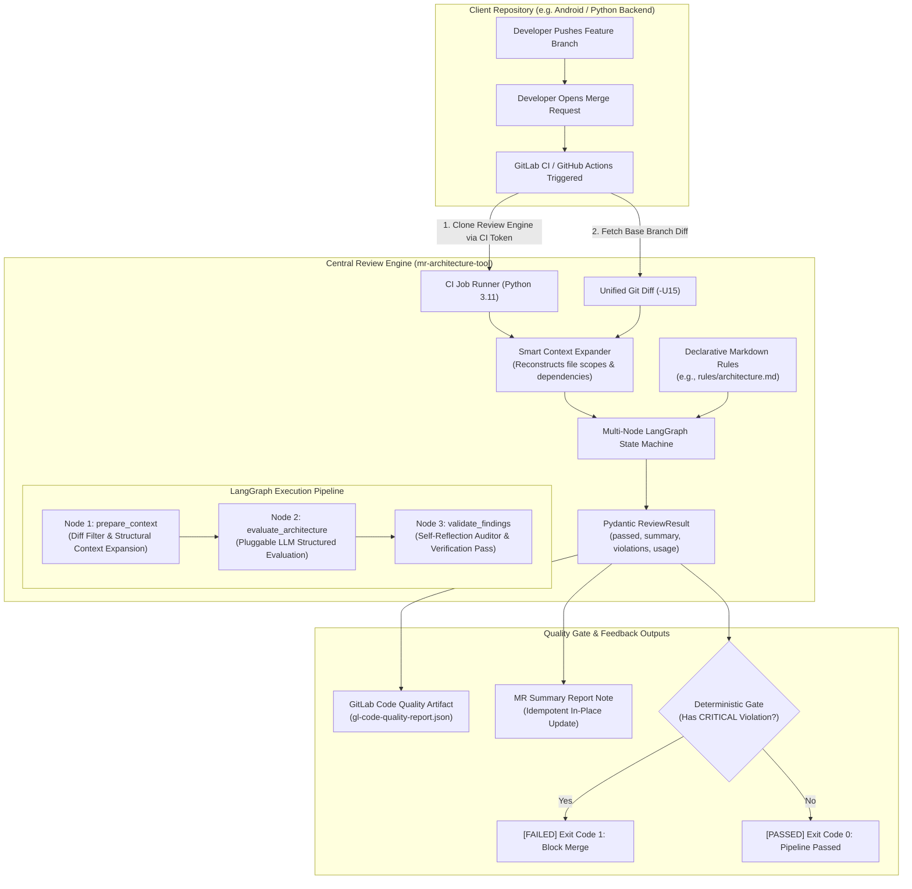
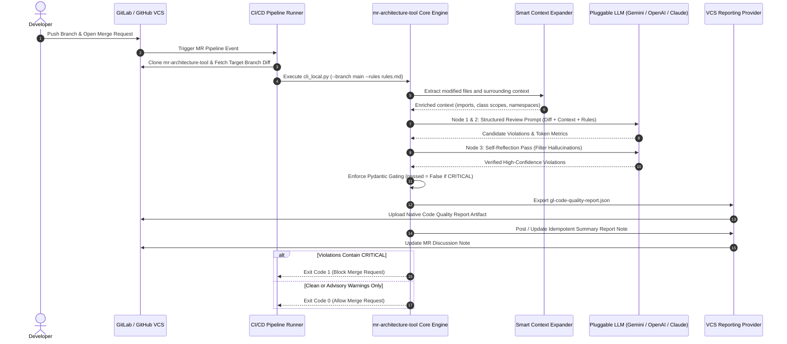
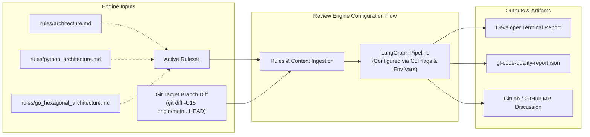
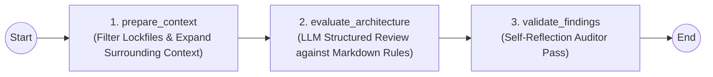

# Merge Request (MR) Architectural Compliance Engine

> An automated, platform-agnostic architectural compliance and quality gate for Merge Requests and Pull Requests.  
> Built with Python 3.11+, LangGraph, Pydantic v2, Smart Context Expansion, and Pluggable LLMs (Google Gemini, OpenAI, Claude, or Local LLMs via vLLM/Ollama).

[](https://www.python.org/downloads/)
[](https://github.com/langchain-ai/langgraph)
[](https://docs.pydantic.dev/)
[](#pluggable-llm--llmops-architecture)
[](#production-setup-guide)
[](LICENSE)

---

## Table of Contents
1. [Executive Summary & Problem Statement](#executive-summary--problem-statement)
2. [End-to-End System Architecture](#end-to-end-system-architecture)
3. [Configuration Flow & Rules Engine](#configuration-flow--rules-engine)
4. [Pluggable LLM & LLMOps Architecture](#pluggable-llm--llmops-architecture)
5. [Smart Context Expansion (Beyond Raw Diffs)](#smart-context-expansion-beyond-raw-diffs)
6. [Multi-Node LangGraph State Machine](#multi-node-langgraph-state-machine)
7. [Tools & Technologies Stack](#tools--technologies-stack)
8. [Production Setup Guide](#production-setup-guide)
9. [Native GitLab MR Widget & Reporting](#native-gitlab-mr-widget--reporting)

---

## Executive Summary & Problem Statement

### The Problem: Silent Architectural Decay
In fast-moving engineering organizations, conventional code quality tools have critical blind spots:
* **Syntax Linters (Detekt, ESLint, Flake8, Ruff):** Catch stylistic, formatting, and AST-local syntax issues, but possess zero architectural context. They cannot evaluate cross-layer boundaries, domain isolation, or lifecycle lifespans.
* **Human Code Reviews:** Reviewers focus primarily on feature requirements and PR diffs under time constraints. Layer breaches (such as presentation controllers directly querying database ORMs) and subtle resource leaks easily slip through unnoticed.
* **Generic LLM Code Reviewers:** Feeding raw unified git diffs (`git diff`) into LLMs produces hallucinations and false positives because git diffs hide enclosing classes, modules, and file imports located outside the changed hunk.

### The Solution: Automated Principal Software Architect
The **MR Architectural Compliance Engine** acts as an automated Principal Software Architect in your CI/CD pipeline:
1. **Completely Decoupled & Platform-Agnostic:** Zero framework-specific regexes or language tokens are hardcoded in Python. All architectural policies reside in declarative Markdown rulesets (`rules/*.md`).
2. **Context-Aware Evaluation:** Automatically inspects the surrounding file context (namespaces, imports, and enclosing class/function scopes) across any language (Kotlin, Java, Python, Go, Swift, TypeScript).
3. **Deterministic Quality Gating:** Enforces strict CI failure (`passed = False`, exit code 1) whenever a `CRITICAL` violation is present, while surfacing non-blocking `WARNING` advisories.
4. **Native VCS Integration:** Automatically generates **GitLab Code Quality JSON artifacts** (populating the native MR widget) and posts idempotent, clean review reports.

---

## End-to-End System Architecture

### High-Level Component Interaction



### Complete Sequence Diagram



---

## Configuration Flow & Rules Engine

The compliance engine decouples **execution logic** from **architectural rules**. The same engine evaluates mobile applications, web backends, and microservices without code modifications.



### Declarative Ruleset Structure
Rules are defined in Markdown (`rules/*.md`) using explicit severity definitions:

| Rule Category | Severity | Description |
|---|:---:|---|
| **Presentation Boundaries** | `CRITICAL` | UI controllers, activities, and routers must never call data layers or database sessions directly. |
| **Domain Layer Purity** | `CRITICAL` | Pure business entities and use cases must have zero framework or ORM dependencies. |
| **Encapsulation & Data Leakage** | `CRITICAL` | Infrastructure DTOs or ORM models must not leak across layer boundaries without domain mapping. |
| **Lifecycle & Concurrency Safety** | `CRITICAL` | No leaking long-lived references to UI contexts; no unstructured concurrency (`GlobalScope.launch` / unmanaged threads). |
| **Event Loop Non-Blocking** | `CRITICAL` | Synchronous blocking I/O calls (`time.sleep`, synchronous HTTP) are strictly forbidden inside `async def` routines. |
| **Conventions & Code Health** | `WARNING` | Advisory guidelines: dispatcher injection, immutability, explicit exception handling, and typing. |

---

### Swappable, Platform-Independent Rules (`architecture.md`)

The review engine contains no hardcoded programming language or framework logic.

* **Language-Agnostic Core:** Evaluates Android (Kotlin/Java), Python (FastAPI/Django), iOS (Swift), Go (Microservices), Java/Kotlin (Spring Boot), TypeScript/JavaScript (Node/React/NestJS), C# (.NET), and Rust.
* **Declarative Markdown Policy:** All architectural boundaries, layer separation rules, and best practices reside entirely within standard Markdown documents.
* **Swappable Per Repository:** Teams can supply a custom rules file via the `--rules` CLI flag or CI environment variable, pointing to an internal repository standard or a centralized organizational rulebook.

#### Ruleset Usage Examples:
```bash
# Evaluate an Android Kotlin MR
python cli_local.py --branch main --rules rules/architecture.md

# Evaluate a Python FastAPI / SQLAlchemy MR
python cli_local.py --branch main --rules rules/python_architecture.md

# Evaluate a Go Microservice MR
python cli_local.py --branch main --rules rules/go_hexagonal_architecture.md

# Evaluate an iOS Swift MR
python cli_local.py --branch main --rules rules/ios_viper_architecture.md
```

---

## Pluggable LLM & LLMOps Architecture

```
┌────────────────────────────────────────────────────────────────────────┐
│                   LangGraph Multi-Node State Machine                   │
└───────────────────────────────────┬────────────────────────────────────┘
                                    │ Unified BaseChatModel Interface
                                    ▼
┌────────────────────────────────────────────────────────────────────────┐
│                     Pluggable LLM Abstraction Layer                    │
├───────────────────┬───────────────────┬────────────────────────────────┤
│   Google Gemini   │   OpenAI Models   │        Anthropic Claude        │
│ gemini-3.5-flash  │   gpt-4o / mini   │      claude-3-5-sonnet/haiku   │
├───────────────────┼───────────────────┼────────────────────────────────┤
│  Self-Hosted LLMs │ Enterprise Gateway│     LLMOps & Observability     │
│ vLLM/Ollama/Llama │  Azure / Bedrock  │   LangSmith / Phoenix / MLflow │
└───────────────────┴───────────────────┴────────────────────────────────┘
```

### Model Abstraction & Architecture
The engine is built on **LangChain & LangGraph standard abstractions** (`BaseChatModel`). Google Gemini is used as the default fast and cost-effective model, but the LLM backend can be configured for alternative providers without changing the orchestrator, schemas, or context expander:

| Provider | Supported Models | Configuration |
|---|---|---|
| **Google Gemini (Default)** | `gemini-3.5-flash-lite`, `gemini-1.5-pro` | `GEMINI_MODEL=gemini-3.5-flash-lite`<br/>`GOOGLE_API_KEY=...` |
| **OpenAI** | `gpt-4o`, `gpt-4o-mini` | `MODEL_PROVIDER=openai`<br/>`OPENAI_API_KEY=...` |
| **Anthropic** | `claude-3-5-sonnet`, `claude-3-5-haiku` | `MODEL_PROVIDER=anthropic`<br/>`ANTHROPIC_API_KEY=...` |
| **Self-Hosted / Open-Source** | `Llama 3.3 70B`, `DeepSeek-Coder-V2`, `Qwen 2.5` | Via **Ollama**, **vLLM**, or **LiteLLM Proxy** (OpenAI-compatible endpoint) |
| **Enterprise Cloud Gateways** | Azure OpenAI, AWS Bedrock, Google Cloud Vertex AI | Enterprise IAM auth, zero data retention compliance |

### Enterprise LLMOps & Observability
* **End-to-End Tracing:** Compatible with **LangSmith**, **Arize Phoenix**, and **OpenInference**. Traces capture prompts, intermediate self-reflection verification passes, and latency breakdowns.
* **Token & Cost Tracking:** Every evaluation tracks `input_tokens`, `output_tokens`, and `total_tokens`, enabling cost attribution per team, project, or Merge Request.
* **Structured Output Guarantee:** Leverages native function calling / JSON schema enforcement (`with_structured_output`) to ensure deterministic parsing into Pydantic models.

---

## Smart Context Expansion (Beyond Raw Diffs)

### The Problem with Raw Git Diffs
In a standard `git diff -U15`, only modified lines and immediate neighbors are visible. If a developer edits a method in a class:
* The class signature (`class UserViewModel : ViewModel()`) is 60 lines above and invisible to the LLM.
* The file-level dependencies (`import androidx.lifecycle.ViewModel`) are at the top and invisible to the LLM.
* Without context, an LLM cannot determine whether a modified class is a ViewModel, an Activity, a UseCase, or a Repository.

### The Structural Context Solution
`src/context_expander.py` implements structural heuristics that work across multiple languages:
1. **Module Hierarchy:** Deconstructs path segments (e.g., `app / src / main / java / com / example / ui / payment`).
2. **File Dependencies:** Collects `import`, `from ... import`, `using`, and `require` statements.
3. **Enclosing Declaration Scopes:** Scans backwards from modified lines to identify enclosing `class`, `def`, `func`, `struct`, or `interface` signatures and inheritance hierarchies.

---

## Multi-Node LangGraph State Machine

The review pipeline is modeled as an executable directed graph using `langgraph.graph.StateGraph`:



1. **Node 1: `prepare_context`:** Cleans git diffs by ignoring lockfiles (`package-lock.json`, `poetry.lock`, `gradle.lockfile`), compiled binaries (`.dex`, `.class`, `.jar`, `.so`), and images. Enriches code chunks with smart context blocks.
2. **Node 2: `evaluate_architecture`:** Calls the LLM with structured Pydantic output schemas, evaluating the diff against the declarative rulebook while ignoring cosmetic whitespace or formatting.
3. **Node 3: `validate_findings` (Self-Reflection Auditor):** A verification pass that cross-references candidate issues against actual modified lines (`+` lines) to eliminate false positives before building the final report.

---

## Tools & Technologies Stack

| Layer | Technology | Purpose |
|---|---|---|
| **Language & Runtime** | **Python 3.11+** | Cross-platform core runtime (Linux, macOS, Windows). |
| **Orchestration** | **LangGraph** (`StateGraph`) | Stateful, multi-node workflow orchestration with self-reflection. |
| **Model Abstraction** | **LangChain** (`BaseChatModel`) | Pluggable LLM interface supporting Gemini, OpenAI, Claude, and local models. |
| **Data Validation** | **Pydantic v2** | Type-safe schemas and deterministic quality gating (`passed = False`). |
| **Context Parser** | **Structural Heuristics** | Language-agnostic scope and dependency expansion. |
| **VCS & CI/CD** | **GitLab REST API v4 & GitHub CLI** | MR discussion management, notes update, and CI runner integration. |
| **Reporting Standard** | **GitLab Code Quality Schema** | Native Code Climate subset schema for MR widget integration. |
| **CLI & Testing** | **Colorama, Pytest, Requests** | Terminal ANSI output, integration testing, and HTTP communication. |

---

## Production Setup Guide

### Step 1: Add Review Engine to Your Repository / CI
Any client project can integrate the compliance check in `.gitlab-ci.yml`:

```yaml
stages:
  - compliance

architectural_compliance_check:
  stage: compliance
  image: python:3.11-slim
  rules:
    - if: '$CI_PIPELINE_SOURCE == "merge_request_event"'
  variables:
    GEMINI_MODEL: "gemini-3.5-flash-lite"
    GIT_DEPTH: "0" # Full git history to resolve base branch comparisons
  before_script:
    - apt-get update && apt-get install -y git
    - pip install --upgrade pip
    - git clone https://gitlab.com/debbiswas2002/mr-architecture-tool.git /tmp/mr-architecture-tool
    - pip install -r /tmp/mr-architecture-tool/requirements.txt
  script:
    - git fetch origin "$CI_MERGE_REQUEST_TARGET_BRANCH_NAME"
    - >
      python /tmp/mr-architecture-tool/cli_local.py
      --branch "origin/$CI_MERGE_REQUEST_TARGET_BRANCH_NAME"
      --rules /tmp/mr-architecture-tool/rules/architecture.md
      --export-codequality gl-code-quality-report.json
      --post-gitlab-comments
  allow_failure: false # Strict quality gate: blocks non-compliant MRs from merging
  artifacts:
    when: always
    reports:
      codequality: gl-code-quality-report.json
    paths:
      - gl-code-quality-report.json
    expire_in: 7 days
```

### Step 2: Configure Environment Variables
Set the following masked CI/CD variables in your repository:
* `GOOGLE_API_KEY`: API key for Gemini (or `OPENAI_API_KEY` / `ANTHROPIC_API_KEY`).
* `GITLAB_TOKEN`: Access token with `api` scope (required for posting summary notes to MR discussions).

### Step 3: Local Developer CLI Workflow
Developers can validate branches or patch files locally before opening an MR:

```bash
# Test current git branch against main
python cli_local.py --branch main

# Test against a custom ruleset
python cli_local.py --branch main --rules rules/python_architecture.md

# Evaluate a specific .diff or .patch file
python cli_local.py --diff samples/violation.diff

# Export GitLab Code Quality JSON artifact locally
python cli_local.py --diff samples/violation.diff --export-codequality gl-code-quality-report.json
```

---

## Native GitLab MR Widget & Reporting

### 1. Native GitLab Code Quality Report Widget
The engine generates `gl-code-quality-report.json` conforming to GitLab's Code Quality schema:
```json
[
  {
    "description": "The router endpoint directly queries UserOrmModel without delegating to a Domain Service. (Recommendation: Delegate all data operations to a Domain Service)",
    "check_name": "Rule 1.1: Presentation Layer Boundaries",
    "fingerprint": "1f8e24c9657062f6277054ddcecaec3d",
    "severity": "critical",
    "location": {
      "path": "src/api/routers.py",
      "lines": {
        "begin": 48
      }
    }
  }
]
```
GitLab automatically parses this artifact to render an interactive health card directly inside the Merge Request overview page:
> "Code Quality degraded on 3 points (3 Critical)"

### 2. Idempotent MR Discussion Summary Note
The bot publishes a single high-level Markdown report on the MR discussion thread:
* Displays review status badge (`[FAILED]` / `[PASSED]`), executive summary, violations table, and token metrics.
* **Idempotent In-Place Updating:** Re-running the pipeline updates the existing bot note via `PUT /notes/:id` using a hidden marker comment (`<!-- mr-validation-summary-marker -->`), eliminating comment spam.

---

## License

This project is licensed under the MIT License.
